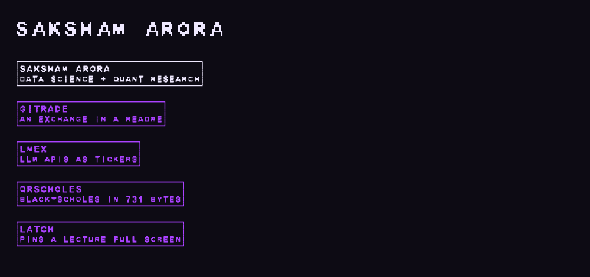

# Saksham Card

A typeface where certain words stop being words.



Type a project name in lowercase and an OpenType ligature swaps the entire
sequence for a single glyph that draws that project's card. Type the same
letters in capitals and they stay ordinary letters.

**[Try it live](https://saksham10arora-dotcom.github.io/portfolio-font/)** ·
[download the .ttf](dist/SakshamCard.ttf)

```
saksham   ->  [ SAKSHAM ARORA / data science + quant research ]
SAKSHAM   ->  S A K S H A M
```

## The words that transform

`saksham` · `gitrade` · `lmex` · `qrscholes` · `latch`

## How it works

Every glyph is a pixel grid turned into outlines. Each row's consecutive ink
cells are merged into one rectangle, so a letter is a handful of contours
instead of one per pixel.

A card is not an image. It is a single glyph, several em wide, built the same
way from a grid holding a border, a title and a subtitle. The `liga` feature
maps the letter sequence onto it.

Lowercase and uppercase are **separate glyphs with identical outlines**. The
substitution rules are bound only to the lowercase ones, which is the whole
trick: `saksham` becomes a card, `SAKSHAM` stays readable. Without that split
the ligature fires on both and you cannot write your own name.

Cards are drawn at a finer grid than letters. At the letter scale a card came
out sixteen ems wide, which overflowed the rasteriser and looked absurd inline.

## Build it

```bash
python3 scripts/build_font.py     # writes dist/SakshamCard.ttf
```

Needs `fonttools` and `pillow`. Editing the `CARDS` dictionary in
`scripts/build_font.py` is enough to add your own.

## Verified

The ligature was checked in a real browser rather than assumed, by measuring
rendered advance widths:

| typed | width | outcome |
|:--|--:|:--|
| `saksham` | 333px | ligature fired |
| `sakshan` | 232px | plain letters |
| `SAKSHAM` | 232px | plain letters |

It is a real `.ttf`, so the ligatures also fire in Figma, Word, and any
terminal that shapes OpenType text.

---

[saksham.digital](https://saksham.digital) · MIT
